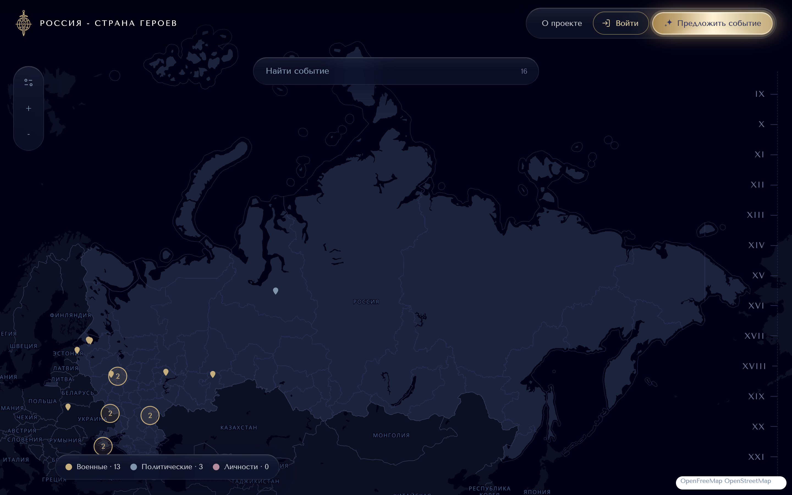
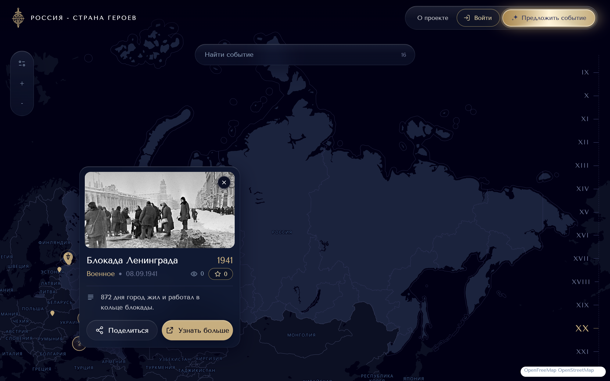
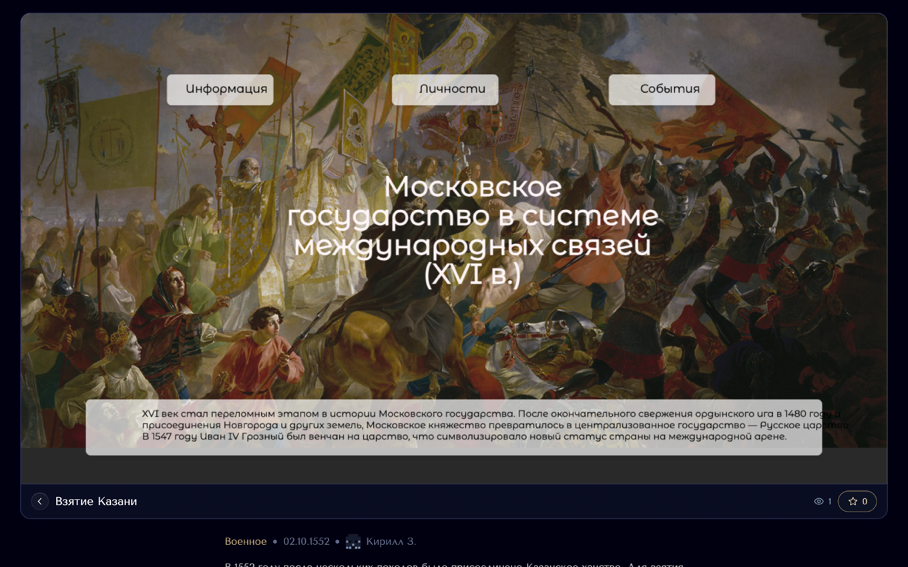
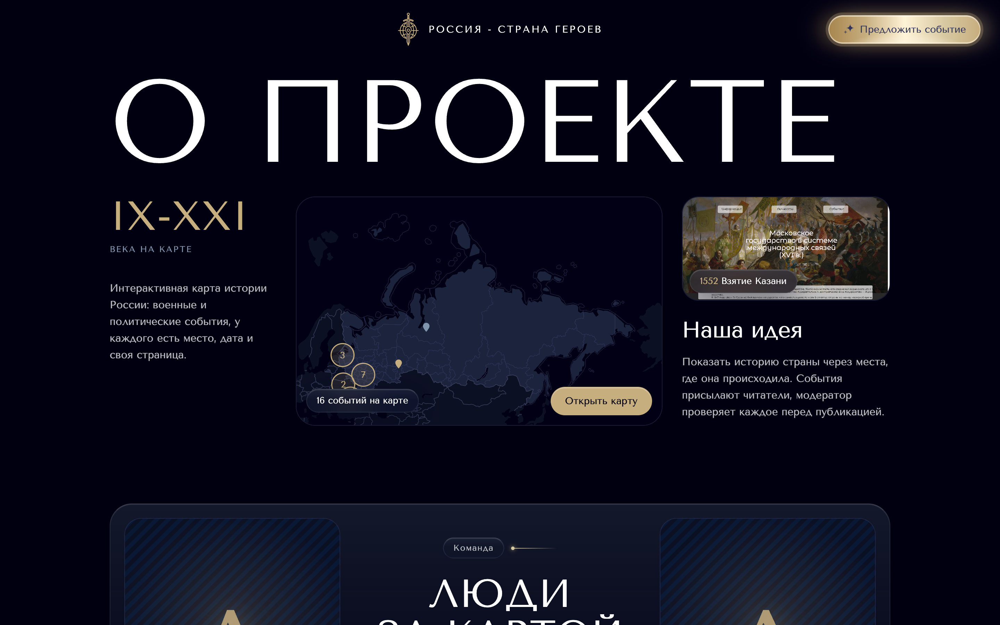
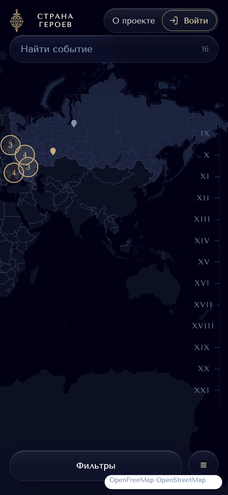
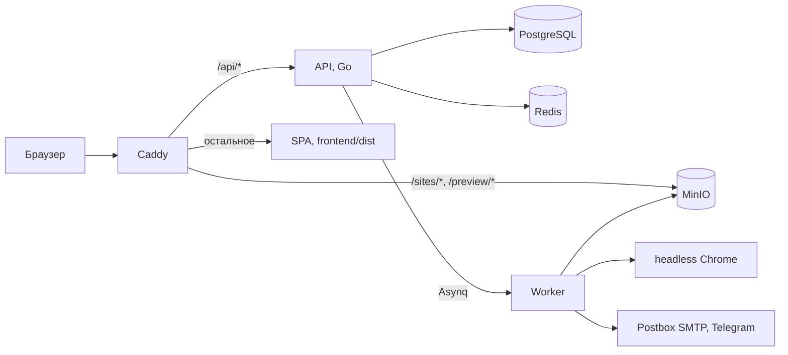

<div align="center">


# Россия - страна Героев

Интерактивная карта исторических событий России. Каждое событие на карте - отдельный
сайт, который сделал и прислал участник проекта.

[russia-heroes.ru](https://russia-heroes.ru) · [API](backend/docs/openapi.yaml) · [Дизайн-система](docs/design-system.html)

</div>



## Что внутри

- **Карта.** Метки трёх типов: политические и военные события, личности. Фильтр по типу и шкала веков,
  подложка OpenFreeMap, границы регионов из OSM.
- **Страница события** `/event/:id`. Сайт автора в рамке на весь экран, под ним дата, тип,
  автор и описание. Посетители ставят звёзды, уникальные просмотры считаются по активному времени.
- **Заявка.** Вошедший пользователь присылает ZIP со статическим сайтом и ставит точку на карте
  (поиск места через Nominatim идёт с сервера). Worker распаковывает архив в MinIO и снимает
  превью в headless Chrome.
- **Модерация** `/admin`. Очередь заявок, проверка, публикация с координатами или отказ
  с причиной. Супер-админ назначает роли, видит журнал действий и настраивает Telegram-бот
  и почту для уведомлений.
- **Аккаунты.** Регистрация с подтверждением почты, профиль автора `/u/:id` с его событиями.
  Тексты о персональных данных и согласия - в `docs/legal/`.

## Скриншоты

| Событие на карте | Сайт события |
|---|---|
|  |  |
| **О проекте** | **Как сделать сайт** |
|  |  |

<p align="center">
  
</p>

## Устройство



| Каталог | Что это | Стек |
|---|---|---|
| [`frontend/`](frontend/README.md) | SPA: карта, заявка, профиль, панель модерации | Vite 8, React 19, TypeScript, React Router 7, MapLibre GL 6 |
| [`backend/`](backend/README.md) | API, worker обработки архивов, миграции, уведомления | Go 1.26, PostgreSQL 18, Redis, MinIO, Asynq, chromedp |
| [`docs/`](docs) | дизайн-система, документы по ПДн, заметки по архитектуре | |

Потоки данных и роли модулей бекенда описаны в [`docs/ai/architecture.md`](docs/ai/architecture.md).

## Запуск

Только фронтенд, с данными живого сайта:

```bash
cd frontend && npm install && VITE_API_PROXY=https://russia-heroes.ru npm run dev
```

Полный стек в Docker (API на `:7666`, Caddy на `:8080`, фронтенд по умолчанию проксирует `/api` туда же):

```bash
cd backend && cp .env.example .env
docker compose -f docker-compose.dev.yml up -d db redis minio chrome
docker compose -f docker-compose.dev.yml run --rm migrate
docker compose -f docker-compose.dev.yml run --rm bootstrap-admin
docker compose -f docker-compose.dev.yml up -d
```

Переменные окружения и требования к загружаемым архивам - в [`backend/README.md`](backend/README.md).

## Проверки и деплой

- Бекенд: GitHub Actions на каждый push в `backend/` гоняет `go test -race`, `go vet`,
  `golangci-lint` и сборку образа.
- Фронтенд: линтера и тестов нет, перед коммитом `npm run build`.
- Push в `main` = деплой. Workflow `Deploy` заходит на сервер ключом с forced command, тот
  подтягивает `main` и запускает [`deploy.sh`](deploy.sh): сборка фронтенда, образы бекенда,
  миграции, `docker compose up`.

## Лицензия

[Apache 2.0](LICENSE)
